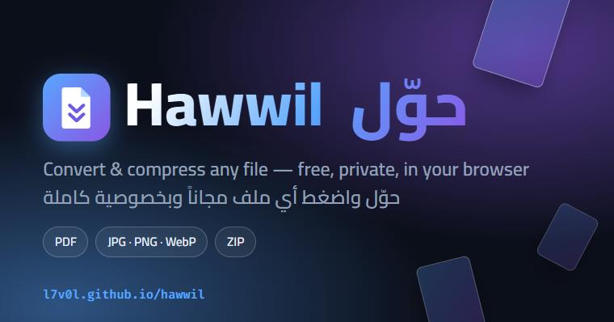

# Hawwil | حوّل

**Convert and compress any file, free and private, right in your browser.**
**حوّل واضغط أي ملف مجاناً وبخصوصية كاملة، داخل متصفحك.**

**[🚀 Open the site | افتح الموقع](https://l7v0l.github.io/hawwil/)**

## Tools | الأدوات

| Tool | الأداة |
|:--|:--|
| Images to PDF | تحويل الصور إلى PDF |
| PDF to Images | تحويل PDF إلى صور |
| Image Converter (JPG / PNG / WebP) | محوّل الصور |
| Text & Documents to PDF (TXT, Markdown, HTML, CSV, JSON) | تحويل النصوص والمستندات إلى PDF |
| Merge PDF | دمج ملفات PDF |
| Split PDF | تقسيم PDF |
| Rotate PDF | تدوير PDF |
| Compress Files (images, PDF, anything) | ضغط الملفات |
| Compress Images | ضغط الصور |
| Compress PDF | ضغط PDF |
| Create ZIP | إنشاء ZIP |

## Features | المميزات

- **Private:** files are processed in your browser and never uploaded. | **خصوصية:** تتم المعالجة في متصفحك ولا تُرفع الملفات.
- **Free:** no limits, no watermarks, no account. | **مجاني:** بدون حدود أو علامات مائية أو حساب.
- **Arabic and English** interface with full right-to-left support, including Arabic documents in PDF. | واجهة عربية وإنجليزية مع دعم كامل للكتابة من اليمين لليسار.
- Custom logo and icon set, animated 3D background (three.js), smooth page and card animations, and guided option controls instead of dropdowns.
- Light and dark mode, responsive on every screen size, honors "reduce motion".
- Installable as an app (PWA) and works offline after the first visit.
- No build step, no framework. Libraries are bundled in `vendor/`.

## Limits | حدود يجب معرفتها

- Everything runs on your device, so very large files depend on your device's memory.
- Text and documents are converted by rendering them as page images, so the text in those PDFs is not selectable.
- "Strong" PDF compression also turns pages into images. "Light" mode keeps the text but usually saves less.
- Word, Excel, and PowerPoint conversion are not included yet.

## Credits

[three.js](https://github.com/mrdoob/three.js), [pdf-lib](https://github.com/Hopding/pdf-lib), [PDF.js](https://github.com/mozilla/pdf.js), [JSZip](https://github.com/Stuk/jszip), [marked](https://github.com/markedjs/marked), [html2canvas](https://github.com/niklasvh/html2canvas).

## Support | دعم المشروع

If this helped you, give it a ⭐. Found a bug or have an idea? Open an [Issue](https://github.com/l7v0l/hawwil/issues).

## License

MIT. The bundled libraries keep their own licenses.
